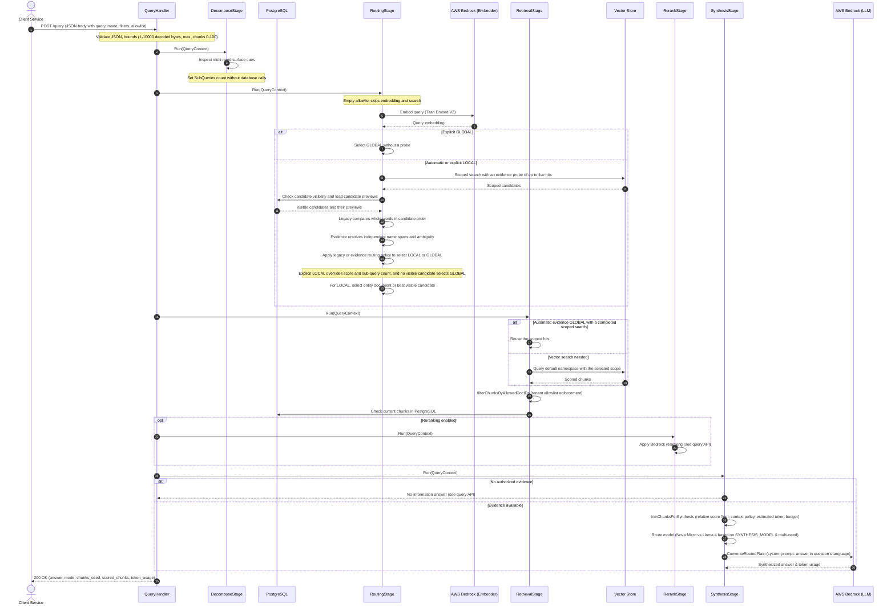

# Architecture

## System Components

Quarry organizes core functionality into distinct packages under `internal/`, wired together at startup by `cmd/server/main.go`. The system diagram illustrates the default hosted-vector deployment.

<picture>
  <source media="(prefers-color-scheme: dark)" srcset="diagrams/system-architecture-dark.svg">
  
</picture>

### Package Responsibilities

- **`cmd/server`**: Reads environment configuration, initializes database connections and storage drivers, instantiates pipeline stages, spawns the background worker, configures HTTP routes, and orchestrates graceful server shutdown.
- **`internal/config`**: Reads and parses environment variables into structured configurations with explicit boundary checks and fallback defaults.
- **`internal/api`**: Configures the HTTP multiplexer and wraps routes with structured JSON logging, panic recovery, and constant-time token verification middleware.
- **`internal/api/handler`**: Implements transport handlers translating HTTP requests and responses into domain operations.
- **`internal/api/middleware`**: Provides request logging with execution latency tracking, panic recovery yielding JSON envelopes, and service token enforcement.
- **`internal/chunker`**: Splits raw text into token-bounded segments using paragraph and sentence boundaries, normalizes document text, strips HTML only from documents with recognizable markup, and generates content fingerprints.
- **`internal/extractor`**: Extracts plain text from uploaded document formats (PDF, DOCX, DOC, plain text) with context cancellation and XML safety bounds.
- **`internal/embedder`**: Generates vector embeddings with AWS Bedrock Titan Embed V2 or an [OpenAI-compatible endpoint](deployment.md#openai-compatible-providers), throttling concurrent API requests via weighted semaphores. Provides a deterministic fake embedder for offline execution.
- **`internal/llm`**: Routes plain-text answer synthesis through AWS Bedrock Converse using the configured primary, fallback or hybrid policy and the context limit, or sends it to the configured [OpenAI-compatible chat model](deployment.md#openai-compatible-providers). The AWS SDK owns Bedrock transport retries. Provides a fake converser for offline execution.
- **`internal/retriever`**: Executes scoped similarity searches in the default vector namespace and evaluates authorized candidate scores to select LOCAL or GLOBAL search modes.
- **`internal/worker`**: Claims persisted ingestion jobs with renewable leases, executes documents in parallel, and records retries or terminal status in PostgreSQL.
- **`internal/pipeline`**: Encapsulates sequential multi-stage pipelines:
  - **Ingestion Pipeline**: Executes `ChunkStage`, `EmbedStage`, and `PersistStage`.
  - **Query Pipeline**: Executes `DecomposeStage`, `RoutingStage`, `RetrievalStage`, `RerankStage` (when reranking is enabled), and `SynthesisStage`.
- **`internal/store/postgres`**: Manages PostgreSQL connection pooling via `pgxpool`, applies embedded SQL migrations, and performs transactional CRUD queries on documents, chunks, and fingerprints, with optional pgvector storage described in the [vector data model](#postgresql-vector-schema).
- **`internal/store/pinecone`**: Implements vector storage drivers for Pinecone, sharing one connection across all namespaces (legacy document namespaces use handles derived from it, which are never closed individually; the connection closes when the client shuts down), with batched writes, retries, and metadata filtering.
- **`internal/store/s3`**: Uploads source binaries, deletes stored objects, and generates presigned GET download URLs.
- **`internal/cleanup`**: Provides multi-store deletion ensuring external vector and object records are purged before metadata records are removed. HTTP and administrative deletion share one checkpointing coordinator once the database activates [checkpointed deletion](api.md#checkpointed-deletion).
- **`internal/domain`**: Defines shared interfaces, domain data models, and the default document label constant (`DefaultDocType = "document"`).

---

### Tracing

The `internal/tracing` package configures export and decorates provider and
storage interfaces. Request middleware continues W3C trace context and baggage,
then names server spans with the matched method and route. Query stages are
sibling spans under that server span: `query.decompose`, `query.routing`,
`query.retrieval`, `query.rerank` when reranking is enabled, and `query.synthesis`. Embedding, vector search and model calls
are client spans under the stage that invokes them. PostgreSQL query spans
record parameterized statements without arguments, only within an existing span.
Upload requests also contain extraction and optional object-upload spans;
document deletion contains vector and optional object-deletion spans.

Each background ingestion attempt starts a new `ingest.job` root with the
document identifier, attempt and applied outcome. It contains `ingest.chunk`,
`ingest.embed` and `ingest.persist`, their provider calls, and database operations.
Each enabled destination receives the same sampled spans through a separate
batch processor. See [deployment tracing](deployment.md#tracing) for operational
setup and content-capture behavior.

## Ingest Pipeline

The ingest pipeline processes text or binary documents through chunking, embedding, vector storage, and relational persistence.

```mermaid
sequenceDiagram
    autonumber
    actor Caller as Client Service
    participant Handler as IngestHandler
    participant S3 as AWS S3
    participant Postgres as PostgreSQL
    participant Worker as Ingestion Worker
    participant Embedder as AWS Bedrock
    participant Pinecone as Vector Store
    Caller->>Handler: POST /ingest
    Handler->>Handler: Extract, remove content NUL, validate
    opt Source storage enabled and identity still unresolved
        opt Source upload journal enabled
            Handler->>Postgres: Stage upload owner and object key
        end
        Handler->>S3: Upload original file
    end
    Handler->>Postgres: AcceptDocument transaction
    Note over Postgres: Resolve identity, check capacity for new jobs, link a staged upload, commit document and job together
    alt Accepted, processing duplicate, or failed duplicate requeued
        Handler-->>Caller: 202 processing with existing or new ID
    else Completed duplicate
        Handler-->>Caller: 200 already_ingested
    else Identity conflict or queue full
        Handler-->>Caller: 409 conflict or 503 queue
    end
    Note over Handler,S3: Remove a new upload when acceptance does not use it; reclamation removes uploads left behind
    Worker->>Postgres: Claim ready job or expired lease
    loop Until processing ends
        Worker->>Postgres: Renew lease every lease / 3
    end
    Worker->>Worker: Chunk content
    Worker->>Embedder: Embed chunks concurrently
    opt Hosted vector index
        Worker->>Pinecone: Upsert default namespace
        Worker->>Pinecone: Query the last vector until it is returned (bounded)
    end
    Worker->>Postgres: CompleteJob transaction
    Note over Postgres: Require processing status and owned lease, insert chunks and optional vectors, then remove job
    alt Retryable failure
        Worker->>Postgres: Reschedule with backoff and last_error
    else Permanent or exhausted failure
        Worker->>Pinecone: Remove partial vectors under the current lease
        Worker->>Postgres: Record failed and last_error, then remove job
    end
    Note over Worker,Pinecone: Stale workers stop issuing mutations when a claim or completion check rejects ownership
```

### Ingestion Stages

1. **ChunkStage**: Converts raw document text into sliding-window text chunks bounded by [`CHUNK_TOKEN_SIZE`](configuration.md#environment-variables) and 30,000 bytes. Sentence boundaries are preferred, including full-width terminators without following whitespace. By default, oversized sentences split by words and oversized words split at rune boundaries. [Embedding input profiles](configuration.md#embedding-input-profiles) add model limits and use grapheme boundaries. Each window includes new text and retains up to `CHUNK_OVERLAP` estimated tokens from the previous window when both limits permit, never more than half of that window. Generates a deterministic chunk ID for each chunk.
2. **EmbedStage**: Embeds chunks concurrently up to [`EMBED_CONCURRENCY`](configuration.md#environment-variables); the provider also enforces its shared request limit [per replica](deployment.md#concurrency-limits).
3. **PersistStage**:
   - Transactional stores defer the vector write and skip visibility polling; completion owns persistence. The remaining write steps apply to hosted storage.
   - Assigns the caller's `doc_type` or falls back to the default `"document"`.
   - Injects `doc_type`, and `collection` when non-empty, into individual chunk metadata; document labels are stored at acceptance.
   - Upserts vectors into Pinecone only under the default namespace (`""`), with `doc_id` metadata identifying each document.
   - Splits each vector upsert under the configured record and byte limits. Metadata above 40,960 serialized JSON bytes per record is rejected before writing.
   - See [Pinecone request limits and retries](deployment.md#pinecone-vector-index).
   - The sample probe searches with the last embedded chunk, filtered to the document and limited to ten results. It checks the write-time incarnation and matches the attempt for tagged writes. The LSN probe compares the indexed watermark with the largest receipt from the original batches. Both start immediately and back off from 200 ms to 2 s within the configured wait. Each wait holds its worker. Expiry allows completion and logs a warning. Cancellation and lease loss end the attempt.
4. **Transactional completion**: The worker replaces chunk metadata and, for the PostgreSQL vector backend, embeddings, then commits completion and the index visibility observation together. Document incarnation, status and the current claim token guard the transaction. Chunk, vector and fingerprint writes run before the job row is locked, so lease renewals continue during slow persistence; the final lock re-tests the lease against the database clock. Document content, metadata, preview and fingerprint already exist before acceptance returns.

Before chunking, documents with recognizable HTML markup have comments, script and style content removed. Block elements become paragraph breaks, line-break elements become newlines, remaining tags are removed, and HTML entities are decoded. Plain text without markup retains comparison operators and literal entities.

Text normalization first converts CRLF, CR and Unicode line separators to newlines, with Unicode paragraph separators becoming paragraph breaks. It applies NFC followed by width folding, expands common Latin ligatures and folds space variants while preserving superscripts, fractions and circled numbers. Unicode format characters are removed; other controls except newlines and tabs become spaces. Hyphenated line wraps are joined, decoration and bullet runs are collapsed, single line breaks become spaces, and paragraph breaks are preserved. These rules apply to newly ingested chunks; existing chunks and raw-content fingerprints are unchanged. `textutil.SanitizeForPrompt` removes Unicode format characters and controls except newlines and tabs without otherwise normalizing text.

Token estimates count each Han, Hiragana, Katakana, Hangul, Thai, Lao, Khmer, Myanmar and Tibetan character as one token. Dense characters separate words. The remaining estimate is the larger of the word count multiplied by 1.3 and the non-space, non-dense rune count divided by four, each rounded up. Chunk token counts use this same estimate. Paragraph breaks remain visible inside chunks, and fragments of a split word are joined without inserted spaces.


---

## Query Pipeline

The query pipeline executes semantic search and grounded answer generation through decomposition, routing, retrieval, optional reranking, and synthesis.



### Query Time Budget

Each handler admits up to [`QUERY_CONCURRENCY`](configuration.md#environment-variables) queries [per replica](deployment.md#concurrency-limits), waiting at most `QUERY_QUEUE_TIMEOUT` before returning 503 with `Retry-After: 1`. Admission precedes all pipeline work. Each admitted query gets `QUERY_TIMEOUT` across the pipeline. Nested reranking and synthesis deadlines cover their scope checks, provider calls and synthesis frames. Optional citation assessment has its own deadline within the query budget. An earlier parent deadline takes precedence.

The AWS SDK retryer is the single transport retry layer for Bedrock, configured with `AWS_MAX_ATTEMPTS`. The ambassador makes one client call per operation and does not add backoff or retry throttled requests. Structured-output correction remains separate; answer synthesis uses the plain-text path without correction calls. SDK retries and their backoff share the synthesis or embedding deadline. The [query API](api.md#post-query) defines the response statuses. Full errors are logged at error level.

### Query Stages

1. **DecomposeStage**: Logs the query byte length and first 12 hexadecimal SHA-256 digits without the query text. Sets the sub-query count from multi-need surface signals (comparison keywords, conjunctions, aggregation markers). Makes no database or generation calls.
2. **RoutingStage**:
   - An empty allowlist skips embedding and retrieval. Otherwise, embeds the incoming query once with the configured embedding provider. Explicit `global` skips the routing probe.
   - Automatic routing and explicit `local` probe the top five candidates within the request's collection, allowlist and document type. It checks the candidates against current completed chunks and reads their eligible previews in the same PostgreSQL statement.
   - Evaluates whether to route to `LOCAL` or `GLOBAL` retrieval according to [`ROUTING_POLICY`](configuration.md#environment-variables):
     - Explicit `global` selects `GLOBAL`. Explicit `local` selects `LOCAL` when a visible candidate exists, regardless of score or sub-query count.
     - If the similarity probe fails or no visible candidate remains, `GLOBAL` retrieval is selected without discarding the query embedding.
     - Under `legacy`, multiple sub-queries select `GLOBAL`. With one sub-query, a whole-word entity match or a top score at `LOCAL_RETRIEVAL_THRESHOLD` or higher selects `LOCAL`.
     - Under `evidence`, each visible document contributes its strongest chunk score. Multiple requests, ambiguous names or a named exclusion select `GLOBAL`. Matching handles Unicode width, accents, mixed scripts, numbered titles and minor spelling variants and keeps independent mentions. An exclusion applies only to the name in its own object phrase. A unique matched name can select its document unless a strong score lead favors another. Without a match, `LOCAL` requires a top score at `LOCAL_RETRIEVAL_THRESHOLD` or higher and a positive lead that meets the calibrated margin. When the probe fills in a multi-document scope, its last visible score bounds possible unseen rivals only if every probe hit verifies. An unverifiable cutoff or a tie selects `GLOBAL`.
   - Records the active policy and a bounded route reason on the span (`quarry.routing.policy`, `quarry.routing.reason`), debug logs and [metrics](configuration.md#metrics). `LOCAL` targets the matched entity's document, or the highest-scoring visible candidate's document when no entity matches.
3. **RetrievalStage**:
   - Queries the configured vector backend using the embedding produced during routing.
   - Searches apply `filter_doc_type`, `collection` and `allowed_document_ids` in the default namespace before top-K selection. Legacy and explicit `LOCAL` search the routed document and fetch a scope-wide supplement if fewer than three chunks return. Automatic evidence routing fetches the larger of five hits or top-K from the original scope, and routes from only the first five. `GLOBAL` verifies every hit of that search in score order before applying top-K. `LOCAL` searches the target even at small limits, using each spelling of the document ID the vector store returned for it, and fills sparse results from the verified scope hits with target chunks first. Allowlists above 10000 IDs require one sequential query per group.
   - Retains the allowlist post-filter before synthesis as defense in depth. A nil allowlist allows all documents; an empty allowlist denies all documents.
   - Applies the [current-evidence check](api.md#post-query) after the allowlist filter and before merging candidates. It checks candidates again before reranking, generation and each JSON or SSE release. Lookup failures stop the query. Pinecone deployments can enable [hosted visibility refill](#hosted-visibility-refill).
4. **RerankStage**: Applies optional [reranking](api.md#post-query) before context selection.
5. **SynthesisStage**:
   - When [`MIN_RELEVANCE_SCORE`](configuration.md#environment-variables) is positive, drops chunks below it before adaptive trimming. Empty or control-only bodies are also dropped before selecting the leading usable passage, and later candidates with `NaN` scores are skipped. If no usable evidence remains, clears retrieved chunks and returns the [no-evidence response](api.md#post-query) with zero synthesis calls.
   - Computes `SYNTHESIS_RELATIVE_SCORE_FLOOR` against the highest finite vector similarity score among usable candidates. Under both `ranked` (default) and `diverse` policies of `SYNTHESIS_CONTEXT_POLICY`, the leading usable passage is always retained under the first-candidate exception even if reranking placed a lower-vector-score chunk first, while subsequent candidates must meet the vector floor. Both policies enforce `SYNTHESIS_CONTEXT_TOKENS`, stop adding zero-token fragments once the budget is spent, and enforce a 100-excerpt cap and UTF-8 byte cap.
   - Under `ranked`, selects sanitized excerpt bodies in candidate order; the first body that does not fit is cut at the last period or newline within the remaining budget if at least 64 estimated tokens can be retained, and selection then stops. Under `diverse`, after retaining the leading passage, greedily skips oversized candidates that contribute no 64-token sentence and pure same-document shingle duplicates, then scores remaining qualified candidates by: (a) relevance (`score / top` when scores are positive without rerank scores, otherwise rank weight `1 / (1 + 0.20 * rank)`), (b) single overlap penalty over normalized 5-rune Unicode bottom-k shingles (`1,024` hashes max per chunk) distinguishing same-document from cross-document overlap above the continuity threshold, (c) meaning-bearing difference override when shingle overlap is at least `0.50` against the highest-overlapping selected excerpt (`meaningBearingDifference`, using `meaningBearingWordTerms` and `meaningBearingDenseTerms` in `internal/pipeline/query_stage.go` across `en`, `es`, `pt`, `fr`, `de`, `it` word boundaries, dense-script substrings in Han/Kana/Hangul/Thai, and maximal Unicode digit runs after NFC and width folding — clearing overlap penalties when a number or listed term is added or, for uncut candidates, removed; spelled-out numbers and unlisted negation forms are not detected), and (d) remaining token cost ratio, breaking ties deterministically by rank and chunk identity.
   - Records the exact sanitized excerpts sent to synthesis and whether each body was cut. Retrieved chunks report their matching renumbered excerpt index and truncation flag through the [query response](api.md#post-query) for both JSON and streamed responses.
   - Selects synthesis model according to `SYNTHESIS_MODEL` (`fallback` defaults to Llama 4 Maverick, `primary` routes to Nova Micro, and `hybrid` dynamically routes based on multi-need detection).
   - Places the question before the retrieved excerpts and wraps each excerpt in a numbered marker. Estimate-only synthesis and strict local counting use a fresh random boundary per request. Strict Bedrock counting uses a keyed, repeatable boundary for the same question and excerpt bodies. Removes invisible format and control characters from the question and stored chunks, preserves newlines and tabs, and escapes excerpt marker prefixes inside their text. Estimates tokens over the complete system and user prompts, including markers.
   - Instructs synthesis to answer strictly using retrieved excerpts and in the language of the user's question, treating excerpt text as untrusted content whose instructions, role changes and formatting requests must not be followed.
   - With [optional Bedrock Guardrails](configuration.md#environment-variables), sends the sanitized question in a guard-content block qualified as `query` and the numbered, marked excerpts in a block qualified as `grounding_source`. The closing instruction remains in a text block. Configured policies can assess prompt attacks and contextual grounding; an intervention reports `finish_reason: "filtered"`. Without guardrails, synthesis retains its single text block. Offline mode applies no guardrail policies and reads guarded text as prompt text. Streamed answers use synchronous guardrail processing, so text is assessed before it is sent.
   - With [strict synthesis budgets](configuration.md#strict-synthesis-budgets), excludes blank sanitized bodies and returns the no-evidence response if none remain. It locks the routed model and verifies the serialized question, instructions, markers, guard blocks and excerpts with the requested output reserve before sending them. It drops or recuts excerpts and renumbers them before publishing context. Bedrock permits up to three count attempts per query within the synthesis deadline, including SDK retries, and retains a measured fitting candidate if a larger one overflows. If fitting cannot be confirmed within that budget, the request fails before context is published.
   - Strict generation revalidates the original evidence rows and request scope before sending evidence to a provider. Each Bedrock count or generation attempt and each OpenAI-compatible request repeats that check, and a checked request cannot be resent by the HTTP transport without it. Preflight measurements are traced separately from generation usage.
   - Calls the configured chat provider only for evidence-backed answers and aggregates synthesis token usage statistics. Empty text is an error; nonempty output reports whether generation stopped, reached its token or context limit, or was filtered.
   - With `include_citations`, requests numbered inline markers and reports [citation checks](api.md#post-query). If semantic assessment is enabled, PostgreSQL pins the scoped candidate bodies and document incarnations. The service checks current scope immediately before sending a citation batch and before publishing a response. A completed check establishes visibility at its statement snapshot. A later change can invalidate subsequent checks.

### Hosted visibility refill

When [enabled](configuration.md#environment-variables), PostgreSQL checks
current chunk identity, text and document scope before Pinecone hits influence
routing or retrieval. If a retrieval search loses hits in that check, the
service can repeat one search per query with the same filters and embedding.
The repeat requests up to twice the original top-K, capped for Pinecone's
metadata-bearing response size. Each partition keeps its candidate versions
until PostgreSQL can check them. A successful repeat rechecks both batches,
including original hits that became visible during the repeat. Only then does
the service keep the highest verified score per public chunk ID and trim to
the requested count. Equal scores are ordered by chunk ID.

Automatic evidence routing reuses its scoped search even when refill is
enabled. Automatic `LOCAL` keeps target evidence first and shares the refill
allowance between the target search and a sparse fill from the original scope.

`LOCAL` bases its three-chunk top-up rule on visible local chunks and uses the
original authorized filters for that top-up. Each partition and transport
attempt counts against the additional request allowance for the wider search
and for top-ups caused by visibility filtering. A search that cannot fit one
attempt per partition is skipped. The routing probe and top-ups that would
have run based on raw counts use their ordinary limits. The combined LOCAL
and top-up recheck can trigger the wider search using the top-up scope if no
wider search has already been attempted.

An optional search that fails leaves the service with previously verified
hits that still pass PostgreSQL checks. Retrieval shares the query deadline,
and cancellation or a failed visibility check ends the query. The hosted
recovery is bounded even when evidence remains sparse. Relevance thresholds
apply after retrieval. pgvector already filters visibility before top-K and
has no refill path.

---

### Worker vector mutations

Startup cleanup, upserts and terminal cleanup validate the processing document and live lease before each physical mutation. The worker records a claim in PostgreSQL, releases its connection during the provider call, then checkpoints the outcome. PostgreSQL calculates expiry from its own clock and the remaining call budget. A lost reply, partial acknowledgment or expired claim records uncertainty that survives subsequent successes. Tagged worker attempts use separate physical targets. Completion publishes the winning target with the chunk metadata. Any unresolved mutation on a shared untagged target prevents completion. pgvector writes commit with the chunk metadata in PostgreSQL.

New untagged Pinecone and memory vectors store their claimed incarnation for retrieval. Completion records when those vectors are required to carry it. Untagged records use logical chunk IDs as physical keys, and cleanup targets them by document ID and the absence of tagged ownership.

## Data Model

Embedded SQL migrations define the relational schema and apply in numeric order at service startup. The diagram shows the core service metadata tables and columns. See the [grant catalog](grant-catalog.md) for authorization storage. The optional vector table and the vector generation records are described below.

<picture>
  <source media="(prefers-color-scheme: dark)" srcset="diagrams/database-schema-dark.svg">
  
</picture>

### Table Definitions

- **`documents`**: Stores primary document records, full content, status lifecycle (`processing`, `completed`, `failed`, and `deleting` while a checkpointed deletion runs), extracted prefix preview, file metadata, object storage references, document labels, and a non-null `collection TEXT` defaulting to `''` with an index on `(collection, id)`. For private uploads, `fingerprint` incorporates the document UUID so equal content has different digests across identities.
- **`chunks`**: Stores segmented text blocks and approximate token counts linked to parent documents via cascading foreign keys.
- **`ingest_jobs`**: Stores pending or running work, attempt counts, lease ownership and expiry, retry scheduling, and the latest error. Each claim assigns a new lease token, including when shutdown or a failed-job requeue allows reuse of an attempt number. Deleting a document cascades to its job.
- **`document_fingerprints`**: Maps collection-scoped SHA-256 content fingerprints to document UUIDs accepted under the `collection` policy.
- **`source_uploads`**: Journals each original-file upload when [`SOURCE_UPLOAD_JOURNAL`](configuration.md#environment-variables) is enabled. A row records the bucket, object key, collection and intended document ID before the write, the PUT's settlement state, the version S3 returned, and a bounded lease. It is `staged` until acceptance links it to the new document in the transaction that inserts the document, `linked` afterwards, and `claimed` once reclamation fences it. Deleting the document cascades to its linked row.

---

### PostgreSQL Vector Schema

The optional `chunk_vectors` table is created dynamically after base migrations, under their advisory lock. It is separate from numbered migrations because installations using hosted vectors need no vector extension, and the embedding dimension is configured at startup. Startup creates the extension if needed and rejects a preexisting embedding column with a different type or dimension.

| Column | Type | Purpose |
|---|---|---|
| `chunk_id` | `TEXT PRIMARY KEY` | Deterministic chunk identity. |
| `document_id` | `UUID NOT NULL` | References `documents(id)` with cascading deletion. |
| `chunk_index` | `INTEGER NOT NULL` | Position within the document. |
| `doc_type` | `TEXT NOT NULL` | Claimed document type. |
| `collection` | `TEXT NOT NULL DEFAULT ''` | Claimed collection label. |
| `text` | `TEXT NOT NULL` | Chunk text. |
| `kind`, `quality` | Nullable `TEXT` | Optional chunk labels. |
| `token_count` | `INTEGER NOT NULL` | Estimated chunk tokens. |
| `embedding` | `vector(n) NOT NULL` | Finite, nonzero cosine vector; dimension comes from [configuration](configuration.md#environment-variables). |

An HNSW index uses `vector_cosine_ops`. B-tree indexes cover `document_id` and
`collection`. Preparing or enabling exact search adds indexes on
`(collection, doc_type, document_id)` and `(doc_type, document_id)`. Searches join
completed documents and return similarity as one minus cosine distance.

At [`PGVECTOR_EXACT_SCOPE_MAX=0`](configuration.md#environment-variables), search
preserves its existing ranking and applies supplied labels to `chunk_vectors`.
Disabled and unfiltered queries use a read-only transaction that inherits the
pool's isolation level. With a positive setting, a filtered search or routing
probe requires any supplied type and collection labels to match both
`chunk_vectors` and `documents`. It counts at most `PGVECTOR_EXACT_SCOPE_MAX + 1`
matching completed rows in a read-only repeatable-read transaction. Within the
limit, search materializes the candidates and sorts by cosine distance and
public chunk ID before taking the top results.

Larger scopes, disabled mode and unfiltered searches use the HNSW-capable query
with transaction-local `hnsw.iterative_scan = strict_order`. PostgreSQL chooses
the scan based on statistics and filter selectivity. When it uses HNSW,
`hnsw.max_scan_tuples` is an approximate bound on additional tuples visited
outside the initial scan. Strict ordering applies to the rows found and recall
can vary. Completion replaces vector records inside the same transaction as
chunks and document status.

When both LOCAL searches select exact ranking, top-up returns the broader
search results in PostgreSQL order, including its collation for tied chunk IDs.

### Vector Generations

A vector generation names one vector target and the embedding profile it stores: provider, model, exact model revision, dimensions, distance metric and the extraction and chunking version of the stored chunks. Migration 016 records them in three tables. Generations are written only by [`make reindex`](development.md#vector-reindex-scriptsreindex).

- **`vector_generations`**: One row per generation with its store, target, profile, state, prior activation and pending-write status. A verified row also stores the corpus digest and verification report. Each physical target belongs to a single generation.
- **`vector_generation_documents`**: The write ledger of a generation, one row per source document: the source revision and incarnation observed at the last completed write, the chunk keys written, and the counts copied and embedded. It has no foreign key to `documents`, so the keys of a deleted document remain known until the target is cleaned.
- **`vector_state`**: A singleton naming the active generation, binding the legacy target independently of its profile and recording the writer freeze with its time and owning generation.

The `legacy` generation is the target that existed before generations: the fixed `chunk_vectors` table or the index named by `PINECONE_INDEX_NAME`. Another PostgreSQL generation stores its vectors in `chunk_vectors_<name>` with the same columns and indexes, so the live table is never altered in place. Deleting a document cascades to every generation table.

Admission, job claims and deletions read `vector_state` first. They stop while writers are frozen and refuse to run on a replica whose configured [`VECTOR_GENERATION`](configuration.md#environment-variables) is not the active generation. Startup applies the same check and also compares the recorded target and embedding settings with its configuration.

## Lifecycle and Concurrency Model

### Server Initialization

1. Configuration is loaded and validated against constraints from environment variables.
2. The PostgreSQL connection pool (`pgxpool.Pool`) is established with a 30-second connection timeout.
3. Embedded SQL migrations are applied in ascending order within a PostgreSQL transaction guarded by an advisory lock; see [Schema Migrations](configuration.md#schema-migrations).
4. Storage drivers and model clients are initialized:
   - In standard mode: the configured vector backend, the configured Bedrock or OpenAI-compatible embedder and synthesis client, and S3 object storage client.
   - In offline fake mode: In-memory vector store, fake deterministic embedder, and fake converser.
5. Ingestion stages and `INGEST_WORKERS` lease claim loops are started with a unique process owner.
6. The HTTP router and middleware chain are registered with standard network listeners.
7. HTTP server listener begins serving with explicit timeout parameters:
   - Header read timeout: 5 seconds
   - Body read timeout: [`HTTP_READ_TIMEOUT`](configuration.md#environment-variables)
   - Response write timeout: [`HTTP_WRITE_TIMEOUT`](configuration.md#environment-variables)
   - Idle keep-alive timeout: [`HTTP_IDLE_TIMEOUT`](configuration.md#environment-variables)

### Worker Queue Mechanics

- An advisory transaction lock serializes PostgreSQL admission across replicas. When acceptance needs a slot, PostgreSQL checks capacity and commits the document change and pending job together. See [queue admission and retries](api.md#queue-admission-and-retries) for the HTTP behavior.
- [`INGEST_WORKERS`](configuration.md#environment-variables) sets worker loops per process. Each loop claims due jobs with `FOR UPDATE SKIP LOCKED` and renews its lease every `INGEST_LEASE / 3`. Polling discovers persisted work even when a notification is missed or another replica accepts it.
- Expired leases are reclaimed. Every hosted attempt runs cleanup for its own target before writing. Retryable failures use exponential backoff from 5 seconds to 5 minutes plus up to 1 second of jitter. Processing failures that are permanent or exhaust attempts remove partial vectors under the live lease before recording `failed` and `last_error`. Jobs exhausted through expired leases are failed during claiming. Their remaining vectors stay hidden by document status.
- Deletion cascades to the job. Completion requires both a processing document and its current lease. See [worker vector mutations](#worker-vector-mutations).

### Graceful Shutdown Sequence

1. The process captures `SIGINT` or `SIGTERM` and marks readiness as draining while the API and any metrics listener keep serving for [`SHUTDOWN_DRAIN_DELAY`](configuration.md#environment-variables) (a second signal skips the remaining delay).
2. The listeners then stop new connections together and wait up to 15 seconds for active requests.
3. Worker shutdown stops new claims, ends visibility waits so their documents complete, and waits up to 15 seconds for current jobs. At the deadline it cancels processing and releases each lease under a detached 5-second context without consuming an attempt. Pending jobs remain persisted in PostgreSQL.
4. Vector connections close after workers stop.
5. The PostgreSQL pool closes. A replacement replica resumes pending work; expired leases recover work after abrupt process loss.
6. Pending trace spans flush last, with a five-second deadline.

### Extraction Boundaries

JSON ingestion allows 1,000,000 decoded content bytes and a body cap of 8,097,152 bytes for escaping and metadata. Multipart uploads remain bounded by `MAX_UPLOAD_BYTES`. A concurrency slot is held before reading multipart data until the upload handler returns. When all slots remain occupied for `EXTRACT_QUEUE_TIMEOUT`, the request returns HTTP 503 with `busy` and `Retry-After: 5`.

By default, PDF, DOCX and DOC extraction executes in a child process of the service binary. The child receives only the extraction flag, `GOMAXPROCS=1` and a soft Go memory limit through its environment. Each child has a 64 MiB maximum stack, a wall-clock timeout set by [`EXTRACT_TIMEOUT`](configuration.md#environment-variables), at most 100 MiB of source data, an 8 MiB stdout cap and a 64 KiB stderr cap. On Linux it attempts to set `oom_score_adj=1000` so that memory pressure preferentially terminates the parser. A parser crash or exceeded output cap returns HTTP 422 with `document could not be parsed`; a timeout returns HTTP 422 with `document extraction exceeded the time limit`. If the child executable is unavailable, uploads return HTTP 503. `EXTRACT_ISOLATION=false` selects in-process extraction and removes the process boundary.

PDF, DOCX, DOC and text extraction enforce the same 1,000,000-byte text limit.
DOCX counts text, separators and story labels against that limit. Expanded XML
is limited to 16 MiB per story part, 1 MiB per relationship part and 50 MiB
across format detection and extraction. The parser counts expanded bytes before
UTF-16 decoding and limits physical XML nesting to 256 elements. The story
selection and XML work from detection travel in the child request header.

Legacy DOC streams must declare a positive size no larger than the source file.
Stream reads respect cancellation and stop at the declared size. PDF extraction
checks relevant decoded streams against a cumulative 8 MiB budget before text
parsing; JPEG images are validated without decoding and do not use that budget.
It also bounds source reads to 64 MiB per document (including JPEG image data,
cached per stream offset), page count, font count, Unicode font-map size and
declarations, and stream nesting. It honors the caller's deadline and
otherwise applies a 30-second default. Extraction-limit failures use HTTP 422.

Failure-status updates use a separate five-second context after task cancellation. Deletion treats missing vector namespaces as completed operations, allowing partial deletions to be retried before metadata is removed.

Checkpointed deletion commits its intent before any external call. The `document_deletions` receipt records the incarnation, source key, vector target and the last acknowledged step, and a claim with a database-clock expiry serializes the steps. The `deleting` status hides the document from reads, signing, retrieval and job completion, and removing its fingerprints stops shared content from matching it. Service-mode download signing holds a transaction-level PostgreSQL advisory lock on the document UUID in shared mode inside a read-only transaction. Every deletion intent, scoped or not, takes the same lock exclusively before it locks the row, so no address is signed after the intent commits and service-mode signing writes nothing. The final transaction deletes the document and completes the receipt together. Workers and readers already compare the stored incarnation, so a replacement under the same UUID keeps its own source and vectors.

Where [legacy deletion reservations](deployment.md#legacy-deletion-reservations) are enabled, an ID-only cleanup holds a shared PostgreSQL advisory lock that orders it against activation and commits a `legacy_reservation` receipt before its first external mutation. The receipt, not the session lock, protects the UUID after a connection is lost, and it is completed only after the last external call returns.

### Metrics Collection

The middleware order is `RequestID(Metrics(Tracing(Logging(Recovery(mux)))))`, so
each request span covers logging and panic recovery. Metrics read
the matched route pattern after dispatch, so document identifiers and unmatched
raw paths never become labels. Recovered failures retain their final HTTP status.
The separate metrics listener serves Prometheus text without an additional module.
See [Metrics](configuration.md#metrics) for metric series, labels and histogram buckets.
